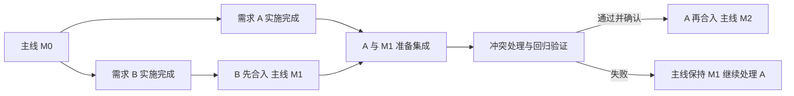

# 轻舟项目需求编排与交付管理 PRD

- 版本：v0.3
- 状态：已按默认方案实施，待产品验收
- 日期：2026 年 10 月 17 日
- 评审对象：轻舟产品负责人及后续实施者
- 实现对照基线：`a122bf7`
- 实施状态：用户已下达“实施”指令；使用说明和验证范围见 [实施记录](../project-workflow.md)

轻舟以项目为持续演进的单位，以需求为完整交付的单位。每条需求拥有一条逻辑上连续的对话、独立代码工作区、多轮执行记录和可检查的交付结果。用户可以逐条实施，也可以并行实施，并按实际需要决定验收与合入的先后顺序。

本次改造要让用户随时看清两件事：各条需求推进到了哪里，以及项目主线实际包含了哪些成果。需求完成实施、用户验收通过、代码合入主线分别记录；自动验证结果必须关联具体代码版本。

## 一 已确认的方向与草案默认值

### 已确认的产品方向

| 编号 | 方向 | 对产品的要求 |
| --- | --- | --- |
| C01 | 项目会不断叠加新的需求 | 需求有稳定身份，项目保留跨需求的全局视图和演进记录 |
| C02 | 一条对话承接一个具体需求的完整落地 | 讨论、实施、补充、返工、验证都能在同一需求下继续 |
| C03 | 串行和并行都会存在 | 同一套工作模式支持逐条启动、同时启动和排队启动 |
| C04 | 实施顺序与合并顺序可以不同 | A 先完成但暂不合入，B 可以先实施并先合入，再处理 A 的集成 |
| C05 | 合并遵循 Git 的版本关系 | 独立分支、冲突处理、最新主线上的验证和合并结果都要可追溯 |
| C06 | 项目需要全局管理和回放 | 能从需求、交付、验收和主线变化追溯项目演变 |
| C07 | 先评审 PRD，再考虑实施 | 本文不构成启动产品改造的指令 |

### 本轮采用的默认值

用户下达实施指令后，本轮采用以下默认值：手动验收具体交付、手动确认最终候选、默认并发 1、前置需求合入后启动、沿用稳定需求详情入口。后续产品验收可继续调整。

| 事项 | 草案默认值 |
| --- | --- |
| 项目与仓库 | 一个项目绑定一个 Git 仓库和一个明确选择的集成分支 |
| 工作区 | 每条实施中的需求使用独立分支和 Git worktree，即同一仓库的独立工作目录 |
| 执行并发 | 默认同时执行 1 条需求；用户可以提高并发上限，并选择多条需求开始 |
| 验收与合入 | 用户验收具体交付版本后，手动发起合入；合入前处理冲突并验证候选结果，最终确认合入 |
| 批量执行 | 选中的需求按顺序及依赖启动；达到待验收状态即可释放执行名额，验收不阻塞独立需求继续实施 |
| 依赖 | 第一版支持以前置需求已合入当前主线作为开工条件；从未合并需求分支派生另一需求留待后续版本 |
| Git 操作范围 | 第一版完成本地交付与集成；推送、PR、发布由独立动作处理 |
| 自由对话 | 保留现有自由对话入口，项目需求对话拥有明确的需求归属 |

## 二 当前基础与产品缺口

轻舟已有 `WorkProject`、`WorkItem`、`WorkRun`、补充反馈、验收操作和项目工作台，可以继续沿用这些基础。

当前项目主要绑定工作目录；需求的执行轮次记录指令、状态和结果摘要。`onWorkItemSettled` 在 Agent 一轮正常结束后记录 `succeeded`，摘要来自最后一条助手消息。工作台已有“需要你处理、进行中、准备开始、最近完成”等分组。

本次需要补齐的能力包括：需求专属工作区、结构化验收与验证证据、交付版本、独立的集成状态、串并行调度、主线回归结果，以及能够串起这些事实的项目时间线。

现有的单文件检查点继续承担文件撤回功能；项目历史和需求交付由完整代码版本承载。原工作目录中的 Git 提交能力需要在实施阶段与需求工作区的归属规则对齐，避免把其他需求或用户已有改动混入交付。

## 三 目标与范围

### 产品目标

1. 用户可以把一条需求从想法推进到实现、验证、验收和合入，过程中始终能找到当前范围与下一步。
2. 多条需求可以同时实施，代码、终端、运行过程与交付结果彼此隔离。
3. 用户可以自由选择独立需求的合入顺序，系统负责准备集成结果、协助处理冲突并重新验证。
4. 项目总览准确区分需求进展与主线已交付能力。
5. 每次交付与主线变化都有版本、验证记录和决策依据，支持只读回放。

### 第一版范围

需求及范围版本、固定对话、多轮执行、独立工作区、串并行启动、基本依赖、交付快照、结构化验证、人工验收、集成队列、冲突处理、主线更新后的重新验证、项目总览、时间线、旧数据兼容及中断恢复。

### 后续范围

自动合入策略、从未合并需求派生的堆叠开发、多个集成分支、远程 PR 与 CI 联动、多人权限协作，以及历史页面或运行环境的可视化快照。

第一版的回放覆盖已保存的需求、代码差异、验证和事件。页面截图或预览等产物只有在当时实际保存后才可回放，不承诺重建完整运行环境。

## 四 核心对象与归属

| 对象 | 含义 | 关键关系 |
| --- | --- | --- |
| 项目 | 持续演进的仓库及集成主线 | 包含需求、项目约定、调度设置和主线历史 |
| 需求 | 一个可以独立验收的交付目标 | 拥有范围版本、逻辑对话、工作区和交付历史 |
| 范围版本 | 某一时点有效的目标、边界与验收标准 | 每轮执行锁定使用的范围版本 |
| 需求对话 | 该需求的连续沟通入口 | 包含多轮执行及集成处理片段 |
| 工作区 | 需求独立分支与工作目录 | 绑定创建基线、当前代码版本和运行资源 |
| 执行轮次 | 一次明确指令下的实施或修复过程 | 关联输入、范围版本、对话边界、代码变化和结束原因 |
| 交付版本 | 一次可审阅、可验证的实施结果 | 绑定需求范围、代码快照、验证证据与结果说明 |
| 验收记录 | 用户对某个交付版本的判断 | 记录验收人、时间、结论和反馈 |
| 集成尝试 | 将指定交付合入指定主线的一次过程 | 关联源交付、目标基线、候选结果、冲突和集成验证 |
| 项目事件 | 已发生的关键事实 | 指向原始需求版本、执行、交付、验收或集成记录 |

一条需求可以有多轮执行和多个交付版本，但用户始终从同一需求入口继续沟通。模型上下文压缩或进程重启不会新建一个无关联的产品级对话；系统用需求约定、最新交付、未完成事项和必要历史恢复上下文。

新的独立能力建立新需求。为满足当前验收标准而补充或返工，继续当前需求。系统可以建议拆分，用户决定归属。

## 五 核心用户场景

### 场景一 逐条实施

用户建立需求 A，明确验收标准并开始执行。Agent 完成实施、相关验证和必要修复，生成交付版本。用户可以先验收并合入 A，再建立 B；也可以保留 A 尚未合入的成果，直接启动独立需求 B。

“上一条实施完成”不隐含“上一条已合入”。B 默认以启动时的项目主线为基线，界面明确展示 B 是否包含 A 的成果。

### 场景二 并行实施与乱序合入

用户同时启动独立需求 A、B。A、B 各自在独立工作区实施。A 先完成，用户暂不合入；B 随后完成并先合入，主线从 M0 变为 M1。之后用户发起 A 的集成，系统将 A 与 M1 组合，处理冲突并运行回归，通过后主线进入 M2。

A 的原始交付、原始验证和用户验收记录仍可查看。A 在 M1 上产生的集成结果及验证另有记录。

### 场景三 没有文本冲突但出现行为回归

A、B 的代码可以被 Git 自动组合，但组合后测试失败。系统保持主线原状，将 A 的集成标为失败并显示失败证据。Agent 在隔离的集成工作区继续修复；修复改变需求行为或超出授权范围时，提出具体问题，等待用户决定。

### 场景四 同一需求补充与返工

用户对交付 D1 提出反馈，在原对话开启新一轮，形成 D2。D1 及其验收记录保留。当前验收状态按 D2 计算，D1 的验收不会自动批准 D2。

用户也可以在执行中补充信息。与本轮范围一致的纠正记录到本轮；改变目标、边界或验收标准的补充先形成范围修订，确认后再应用到后续执行，避免历史范围被覆盖。

### 场景五 已合入能力在后续迭代中回归

登录能力在 M1 已验收并合入。后续需求通过当时的必需检查并合入形成 M2，用户随后补充一项必需的登录回归检查，执行后发现异常。系统保留登录能力的历史交付事实，同时在 M2 的主线状态中显示回归异常，并关联失败检查与相关集成记录。后续恢复也产生新事件。

### 场景六 外部 Git 操作与中断

用户可能在轻舟之外修改分支、提交或合并。轻舟重新检查真实 Git 状态；证据无法覆盖当前版本时，显示需重新验证。应用重启后，用户可以辨认哪些步骤完成、哪些被中断，并选择继续处理。

## 六 需求从提出到交付的流程

### 建立项目与需求

创建项目时选择仓库及集成分支，显示真实仓库根目录、当前分支和未提交改动。分支名称可以是 `main`、`master` 或用户指定的其他分支，不硬编码为 `main`。

非 Git 目录仍可使用现有对话能力。启用需求隔离与集成前，需要用户明确建立或选择 Git 仓库。检测到原目录有未提交改动时，列出影响；创建需求分支不会自动复制这些改动，也不会自动暂存或清除它们。

新需求至少包含标题、目标和验收标准。可以先以草稿讨论，不立即创建 Agent 进程。验收标准可以由 Agent 协助整理，每条标准都应能够说明判断方法。

### 开始执行

用户点击“开始执行”后，系统固定本轮范围版本、输入指令、启动基线和执行策略。首次实施时创建独立工作区；继续实施时沿用当前需求工作区，先检查已有进度。

本轮按明确范围、实施、验证和修复推进。界面展示阶段与实际证据，不使用 Agent 自报的完成百分比作为交付判断。

开始执行授权本需求在既定策略内推进。常规实施和已允许的验证不重复要求用户确认；真实阻塞、范围变化和执行策略规定的高风险操作需要明确处理。

### 形成交付

实施结束后保存本需求的代码快照、变更说明、验证结果和未完成事项。可进入“已实现”的条件是交付快照完整，必需的自动检查已通过；没有可用自动检查的项目必须明确标记验证方式和不足，不能展示虚构的验证通过。

Agent 回答结束但缺少检查证据时，状态停在“待验证”。缺依赖、服务不可用或环境不足属于受阻或未验证，不记为通过。自动修复遵循项目设置的时间或重试预算，预算耗尽后保留现场与具体阻塞信息。

交付封存为可审阅的本地提交或等价的完整 Git 快照，记录代码树身份。只有明确属于本需求并获准纳入的改动进入交付；检测到来源不明的外部改动时，列出文件并等待处理。交付不会自动触发远程推送或发布。

### 验收与继续修改

用户在交付页逐条查看验收标准、变更、产物、自动检查和待人工确认项。操作为“验收通过”或“反馈并继续”。验收结论绑定具体范围版本和交付版本。

已验收后继续改代码、修改验收标准或新增交付时，历史验收记录保留，新版本需要重新验收。用户可以将验收后的交付暂存，稍后再发起集成。

## 七 串并行编排与工作区规则

| 编号 | 规则 |
| --- | --- |
| F01 | 用户可以逐条开始，也可以选择多条需求开始；并发上限为 1 时串行，为大于 1 时并行 |
| F02 | 等待执行的需求按用户设定的稳定顺序排列，状态更新不改变顺序 |
| F03 | 工作区首次创建以实际启动时的主线版本为基线，并记录其 SHA；已启动的工作区不会静默切换到新主线 |
| F04 | 每条需求绑定独立分支、目录、终端与运行过程；同一需求同一时刻只有一个修改代码的活动轮次 |
| F05 | 实施、验证和修复占用执行名额；等待审批或回答的活动进程仍计入资源限制，避免超配 |
| F06 | 待验收、已验收但未合入的需求保留工作区和交付，不继续占用实施名额；空闲 Agent 进程可按资源策略回收 |
| F07 | 开始一批需求只授权实施这批需求，不自动批准验收或合并 |
| F08 | 前置需求尚未合入时，声明依赖它的需求等待；用户可删除不再成立的依赖，但不能创建循环依赖 |
| F09 | 失败阻塞本需求及其依赖；已获授权的独立需求可按队列继续。“暂停全部”是单独的显式操作 |
| F10 | 重新排序不自动停止已经执行的需求，也不会重写需求工作区的基线 |

并行隔离还包括验证环境。项目需要配置可复用的检查命令及必要环境，端口、临时目录和测试数据应可隔离；存在共享独占资源的检查进入资源队列。无法隔离时显示等待原因，不能仅凭工作目录不同就认为环境已隔离。

## 八 状态与界面用语

### 三种独立状态

| 维度 | 主要状态 | 判断依据 |
| --- | --- | --- |
| 实施 | 未开始、排队、执行中、受阻、待验证、已实现 | 调度、实际运行、交付快照与检查证据 |
| 验收 | 未发起、待验收、已验收、需返工 | 当前交付的人工验收记录 |
| 集成 | 未合入、排队合入、准备集成、处理冲突、集成验证、可合入、已合入、集成失败、历史未知 | 真实 Git 状态、集成尝试及候选验证 |

归档是独立的可见性操作，不覆盖以上事实。旧版本曾通过验收而当前版本未验收时，展示“新版本待验收”，历史中仍显示原验收。

需求卡片组合展示用户关心的信息，例如“已实现 · 待验收”“已验收 · 尚未合入”“正在处理合并冲突”“已合入 · 当前主线回归异常”。项目进度中，“实施完成数”和“已合入数”分别统计。

### 主线验证状态

每份主线检查结果绑定具体主线代码树及检查配置。当前版本的必需检查齐全且通过时显示“回归通过”；任一必需检查失败时显示“回归失败”；结果缺失、过期或必需检查未执行时显示“未验证”或“验证中”。

非必需检查失败时，展示“必需检查通过 · 有检查异常”并列出失败项，不用无附加说明的绿色状态掩盖异常；是否阻止合入由项目对该检查的要求决定。

历史需求已经合入的事实不随最新回归失败而消失。界面应指出失败的检查及其关联验收项，无法定位到某条需求时只报告主线检查失败，不让 Agent 的推测成为已确认归因。

## 九 验证与交付证据

### 每次交付保存的内容

| 类别 | 必须保存的事实 |
| --- | --- |
| 范围 | 需求 ID、范围版本、验收条目、输入指令及补充反馈 |
| 代码 | 仓库身份、工作区、启动基线、交付提交或快照 SHA、代码树、文件差异 |
| 验证 | 检查名称、命令、工作目录、检查配置版本、开始与结束时间、退出码、结果与日志引用 |
| 环境 | 与复现有关的操作系统、运行时、依赖或配置指纹；不保存明文凭据 |
| 结果 | 本轮变更说明、关联产物、未验证项、阻塞项及对应对话边界 |
| 验收 | 用户结论、时间、具体交付版本及反馈 |

项目配置检查集合，例如 lint、类型检查、单测、相关集成或 E2E。每个检查标记是否必需，并可以关联验收条目。系统根据真实运行结果填写状态；助手总结用于解释结果。

命令退出成功只证明该命令成功执行。测试数量仅在有可识别结果时显示；无法解析时保留退出码和日志。没有对应自动检查的体验标准保留为人工验收项，不自动打勾。跳过检查必须保存原因，跳过必需检查不会满足合入条件。

### 证据的有效范围

| 发生的变化 | 需要更新的判断 |
| --- | --- |
| 需求范围或验收标准变化 | 新范围建立新版本，当前交付与验收需要重新对齐 |
| 需求代码变化 | 新交付需要重新验证与验收，旧交付证据保留 |
| 主线变化 | 原需求交付证据仍描述原版本；尚未合入的集成候选需要针对最新主线重新准备和验证 |
| 集成解决冲突后修改了候选代码 | 修改前的候选验证失效，针对新候选重新检查 |
| 必需检查集合或关键环境变化 | 受影响的验证结果失效，显示需重新验证 |

源交付、目标主线基线、集成候选代码树和检查配置共同决定一次集成验证是否有效。实际合入的代码树必须与已验证候选一致。

## 十 集成与冲突处理

### 合入流程

1. 用户选择某个交付版本，点击“准备合入”。默认检查该版本已验收、源工作区可识别、必需检查齐全。
2. 系统将该请求加入目标主线的集成队列。界面显示计划合入顺序，允许调整尚未开始的请求。
3. 读取真实源交付和目标主线版本，在独立集成工作区准备候选结果；原需求交付和当前主线保留。
4. Git 存在冲突时，Agent 在集成工作区处理，并在原需求对话中记录“集成处理”片段。需要产品取舍或超出授权范围时，展示具体差异与问题。
5. 无论是否存在文本冲突，都对组合后的候选运行项目必需的回归检查。失败则保持集成失败或继续修复，主线不前移。
6. 候选通过后展示源交付、当前主线、冲突处理产生的额外变化及验证结果。用户可以确认合入，或者反馈并继续处理。
7. 最终写入前再次检查目标主线和源交付身份。主线已变化时，原候选不直接合入，重新准备与验证；源交付变化时要求重新选择交付。
8. 合入成功后记录目标主线的新版本、实际代码树、对应需求、候选及验证证据，更新项目时间线和主线状态。

同一仓库的同一目标分支只有一个活动的集成通道，实施需求仍可并行。即使外部 Git 操作绕过轻舟改变了主线，第 7 步也必须阻止过期结果写入。锁定对象按真实仓库与目标分支识别，不能只依赖轻舟项目 ID。

原项目工作目录有未提交修改，或者当前检出分支不符合预期时，显示影响并等待处理；不自动执行会覆盖用户内容的清理、暂存或强制切换。

### 集成修改与验收的关系

原交付的验收属于原交付。集成解决冲突后增加的改动单独展示，最终合入确认覆盖本次候选。后续如提供自动合入策略，必须明确哪些变化可以沿用已有验收，不能由“无冲突”隐式授权。

同一需求进入集成时固定源交付版本。用户可以继续整理下一轮草稿；修改参与集成的源分支前，应结束或取消当前集成尝试，避免同时写入和目标漂移。

## 十一 三个核心视图

### 项目总览

项目页展示集成分支、当前主线版本、最新有效回归状态，以及需要用户处理的事项。需求列表保留稳定顺序，并支持按实施、验收和集成状态筛选。需求行展示目标、状态组合、依赖或阻塞原因，以及当前可执行操作。

用户可单条开始、选择多条开始、调整队列顺序和并发上限。另设集成队列，避免把实施排序误认为合入排序。“A 已完成但尚未合入”始终能被直接看到。

项目总览提供「需求」「集成队列」「演进与回放」三个独立视图。需求支持列表／看板切换、带数量的状态筛选、搜索和当前可执行需求的批量选择。改变筛选或搜索后清空选择，避免把不可见需求误加入队列。编排设置使用独立弹窗，关闭后返回原视图。

### 需求工作间

需求使用稳定详情页。主要区域为当前需求约定、完整对话、阶段与验收条目、交付及执行历史。查看旧版本时明确显示版本和时间，回到当前版本的入口保持可见。

核心操作随状态出现：开始执行、补充要求、停止本轮、查看交付、反馈并继续、验收通过、准备合入、查看集成结果、确认合入。打开对话不会自动执行或修改代码。技术详情在代码、检查和历史中展开，用户无需先理解分支命名才能推进需求。

桌面工作区并列展示连续对话和操作面板；操作面板分为「交付」「范围」「回放」。顶部显示实施、封存验证、人工验收、集成验证、合入主线五个阶段，以及当前需要处理的下一步。阶段只用于导航，不自动验收或合入。

窄屏使用「连续对话」「需求与交付」切换，保持同一会话和输入草稿。范围和文字消息草稿按需求保存，支持切换需求、关闭重开和刷新恢复。工作区支持上一条／下一条需求，页签支持方向键与 Home／End；菜单支持 Esc 关闭并恢复焦点。对话跟随自己的滚动容器，用户向上阅读时保留当前位置，可主动回到最新。

验收支持记录返工意见。返工记录与继续实施是独立操作，用户可在原对话继续提出要求。

### 项目演进时间线

时间线按实际发生的顺序记录需求建立与范围修订、执行开始与中断、交付形成、验收、集成请求、冲突处理、验证和主线合入。支持按需求及事件类型筛选，并区分实施事件与主线变化。

桌面上使用节点列表与证据面板并列展示，选中节点保持可见；切换筛选或节点时清理上一节点的回放，迟到的对话响应不能覆盖新节点。

点击事件只读查看对应需求版本、执行对话片段、代码差异、检查日志和实际保存的产物。历史事实追加记录，后续总结不会覆盖原始证据。主线节点能列出该版本已经包含的需求及当时的验证状态。

“恢复工作”“重新执行”“撤销已合入变更”是分别发起的新操作。撤销合入通过新的可验证变更进入集成流程，不把历史主线强制重置为旧版本。

## 十二 可靠性与资源管理

1. 应用重启后核对进程、工作区、交付及 Git 引用，区分已完成步骤与被中断步骤。中断不标为成功，也不自动重放有副作用的命令。
2. 同一启动或合入请求具备幂等身份。重复点击、网络重连或恢复不能创建重复工作区、重复交付或重复合入。
3. Git 引用已更新但应用记录尚未写完时，重启后按真实引用和集成记录对账，防止再次合入。
4. 磁盘不足、依赖安装失败、工作区丢失或被外部修改时，保存具体失败原因和仍存在的结果，提供可辨认的恢复路径。
5. 归档隐藏需求，不删除尚未合入的代码。删除工作区单独确认；未合入或存在未封存改动的工作区不能被自动清理。
6. 对话、快照、检查日志和事件遵循本地保存策略。日志脱敏，工作区不自动复制原目录中的密钥及未跟踪文件；需要共享的配置明确配置。

## 十三 现有数据迁移

| 现有对象 | 迁移原则 |
| --- | --- |
| `WorkProject` | 保留身份与目录，补充仓库和集成分支配置；未配置时不启用自动集成 |
| `WorkItem` | 保留需求内容、排序、归属和对话关联，生成初始范围版本 |
| 历史 `WorkRun` | 保留原始状态及摘要，将原 `succeeded` 解释为历史执行正常结束，不伪造验证通过 |
| 原 `completed` 需求 | 保留历史完成和验收记录；集成状态无法从 Git 核实时显示未知，不推断为已合入 |
| 原共享工作目录 | 标为原工作区，既有会话继续可读；新建隔离工作区前检查原改动和基线 |
| 文件检查点 | 保留原功能和路径，不用单文件撤回来表示项目版本回放 |

迁移前保存旧数据备份。迁移后的记录必须能定位原 ID 和原对话。尚未隔离的旧需求不能同时在同一目录写代码；转换到新工作区需要保留历史路径与新路径的对应关系，并验证继续执行时使用的真实目录。

## 十四 第一版验收标准

以下是发布本次改造的必要场景，实施时逐项补齐可重复的自动验证；包含人工判断的部分保留明确的人工验收步骤。

| 编号 | 场景 | 通过条件 |
| --- | --- | --- |
| A01 | 一条需求完整交付 | 从范围确认到实施、验证、验收和合入均可追溯到同一需求与逻辑对话 |
| A02 | 逐条启动 | A 实施结束后可启动独立 B，A 不会因此被自动合入 |
| A03 | 并行隔离 | A、B 同时修改同名文件、运行终端与检查时，工作区及事件归属正确，源主线不被实施过程修改 |
| A04 | 乱序合入 | A、B 同基线启动，A 先完成、B 先合入、A 后合入，主线最终保留两者成果和完整顺序记录 |
| A05 | 文本冲突 | A 的候选发生冲突时，在隔离区解决、重新验证并明确展示额外变化，成功前主线保持原状 |
| A06 | 行为冲突 | Git 自动组合成功但回归失败时，阻止合入；修复后对新候选重新检查 |
| A07 | 过期验证 | 候选验证后目标主线被外部更新，确认合入时阻止使用旧结果，重新集成和验证 |
| A08 | 版本化验收 | 已验收 D1 后产生 D2，D1 记录保留，D2 不沿用 D1 的验收结论 |
| A09 | 验证缺失或跳过 | Agent 回复完成、退出成功或跳过必需检查，都不能伪造完整验证通过 |
| A10 | 依赖与排序 | 依赖不满足时等待且解释原因；独立需求可继续；排序稳定，循环依赖被拒绝 |
| A11 | 名额与暂停 | 并发不超过项目及系统资源限制；待验收释放实施名额；暂停不丢失现场 |
| A12 | 主线回归 | 历史需求已合入后，最新主线回归失败能独立呈现，不改写历史验收事实 |
| A13 | 回放 | 能按需求及主线节点查看当时范围、交付、验证、验收与集成；查看操作不执行历史命令 |
| A14 | 原目录改动保护 | 原工作目录存在未提交修改时，不静默复制、清理或纳入其他需求交付 |
| A15 | 中断与重复请求 | 实施、验证和合入过程中重启或重复请求，恢复后事实一致，无重复合入或虚假成功 |
| A16 | 外部 Git 变更 | 外部修改源分支或目标分支后，重新核对真实状态，无法覆盖新版本的证据明确过期 |
| A17 | 历史迁移 | 旧项目、需求、运行及对话仍可读，历史完成不冒充已验证或已合入 |
| A18 | 归档与清理 | 归档可恢复，未合入或含未封存改动的工作区不会自动删除 |
| A19 | 非默认分支与共享仓库 | 非 `main` 集成分支可用；同一仓库目标分支在不同项目入口下仍共享集成锁 |
| A20 | 平台与原有功能 | macOS 与 Windows 的路径、分支及工作区流程通过原生验证；原自由对话及已有审批功能继续可用 |

验收以场景中的实际结果为准。自动测试数量、Agent 的完成总结或单个页面正常显示，不能替代上述闭环。

## 十五 实施边界与评审决策

### 建议的实施顺序

| 阶段 | 交付内容 | 阶段检查 |
| --- | --- | --- |
| 第一阶段 | 范围版本、交付、验证、验收及集成记录的协议和存储，旧数据兼容 | 历史可读，事实与状态边界准确 |
| 第二阶段 | 需求专属工作区、固定对话、串并行调度、基本依赖及需求工作间 | 独立需求互不污染，逐条与并行都能工作 |
| 第三阶段 | 集成队列、冲突处理、候选回归、主线并发检查及合入 | A 先完成、B 先合入、A 后合入的完整场景通过 |
| 第四阶段 | 项目总览、演进时间线、主线回归、恢复与跨平台验收 | 第一版验收场景完成，原有流程无回归 |

以上是研发拆分顺序。第一版的最小产品闭环包含并行实施及乱序合入；只完成状态展示或需求列表，不视为本次改造完成。

### 评审时需要确定的选择

1. 是否采用“验收具体交付后手动准备合入，再确认最终候选”的默认交互，还是在第一版加入可配置自动合入。
2. 并发默认值是否为 1，以及项目级资源设置需要暴露哪些选项。
3. 第一版是否接受“前置需求已合入才可开工”的依赖约束，还是必须同时支持从未合并分支继续开发。
4. 需求工作间采用完整页面还是继续以现有抽屉为主；无论哪种呈现，需求约定、对话、交付与证据都必须有稳定入口。
5. 历史快照与日志的保留期限、磁盘上限，以及已合入工作区的手动清理体验。

本轮已按用户的“实施”指令接入数据协议、兼容迁移、独立工作区、执行编排、交付验收、候选验证、最终合入和项目回放。验收与平台验证范围见实施记录。

## 十六 现有实现对照

- [工作项目与需求协议](../../packages/protocol/src/work-items.ts)：项目、需求、运行、补充反馈、现有验收状态及工作模式约束。
- [需求执行控制](../../apps/server/src/tasks/work-item-controller.ts)：启动、继续、运行结束及结果摘要的当前行为。
- [工作数据存储](../../apps/server/src/tasks/work-item-store.ts)：历史数据和运行记录的迁移基础。
- [项目工作台](../../apps/web/src/components/board/WorkDashboard.tsx)：项目需求分组与列表的现有入口。
- [需求详情](../../apps/web/src/components/board/WorkObjectivePanel.tsx)：需求说明、验收标准、补充要求和执行历史。
- [Git 操作](../../apps/server/src/tasks/git-status.ts)：当前提交、差异与恢复能力。

## 十七 产品评审补充：决策入口与对话衔接

本轮按用户“全部实施”的指令落实以下交互约定，保持人工验收、人工确认合入和独立工作区规则。

- **入口与权限**：全局“对话”按会话组织探索和临时操作，“工作”按项目和需求组织长期交付。执行权限仍由问答、规划、代理、审阅及审批设置决定。切换入口不启动、停止或结束需求。
- **需求内连续对话**：需求工作区支持“专注对话”“专注审阅”和可拖动、可键盘调整的双栏。同一需求跨布局共享文字草稿、附件与阅读位置；导航分别记住自由对话和项目工作位置。
- **从讨论到实施**：新需求可先进行只读讨论，讨论使用同一需求会话并单独记录轮次，不作为实施或交付。确认目标和验收标准后开始实施。已结束轮次的新输入由需求生命周期派发，附件与指令同时记录；本轮结束收束期间的新提交等待收束完成。
- **聊天整理为需求**：选择项目、讨论片段，编辑目标与验收标准，核对后保存需求草稿。保留原会话引用、片段快照和可用的来源图片，选定片段作为后续轮次的背景，当前确认范围优先。原聊天中的代码和检查不自动成为新需求的交付或验证，未提交改动不自动复制。
- **待我处理**：审批、回答、封存验证、人工验收、返工、冲突和候选确认使用统一入口。每项明确需求、原因及下一动作。其他需求的请求进入列表；打开相应需求后才显示阻塞对话框，且标明项目与需求名称。全局工作动态支持在自由对话中查看待办并直达需求。
- **当前范围**：看板、详情、筛选及统计共用状态投影。历史范围已合入与新范围待实施分别显示，历史交付不能使当前范围显示完成。当前检查有效数和历史合入数明确区分。
- **排队与恢复**：名额包含实施、讨论、验证及准备占用。等待依赖、暂停、名额不足和独占验证资源有具体说明。已归档的已选前置仍显示；用户可以停止排队、调整依赖后重新执行。
- **交付审阅**：行为说明、影响文件、未完成项、封存产物、逐条人工观察与检查引用先于原始日志展示。说明不自动等于通过。产物从实际封存的 Git 版本读取，支持图片和文本报告；每项最大 2 MiB。新旧交付可以比较真实代码差异。返工支持仅记录，或审阅反馈后直接开始新一轮；续做绑定正在审阅的交付，拒绝过期反馈。
- **主线关系**：显示需求原始基线、当前主线及此后合入的需求；明确源交付验证与组合验证的区别。主线版本按真实合入顺序展示，支持两个已记录版本的文件和代码差异比较，撤销需求关联原集成记录。
- **列表整理**：需求对话可以从最近会话隐藏和恢复；聊天入口不允许通过归档会话连带归档需求。归档需求从工作台明确执行，保留原有历史与恢复能力。
- **首次配置**：先检查仓库与目标分支，再审阅检测到的检查脚本，最后设置执行并发。检测和保存配置不会执行脚本。

新增验收场景：自由讨论转需求且不自动实施；只读讨论后在原需求实施；跨布局与刷新恢复附件草稿；并行需求请求不打断当前需求；已归档依赖可恢复处理；候选待确认计入待办；历史合入后修改范围回到待实施；封存产物不受工作区后续修改影响；主线版本比较与撤销关系可追溯。

## 十八、需求设计流程与模块文档

新增 [需求设计流程与模块文档 PRD](requirement-design-lifecycle.md)：需求沟通 → 确认范围 → 确认 PRD → 实施与设计迭代 → 回归验收并固化。工作区设计文件与代码一起交付；模块文档通过关联子 PRD 更新并保留来源，当前确认设计与真实代码合入状态分别呈现。
